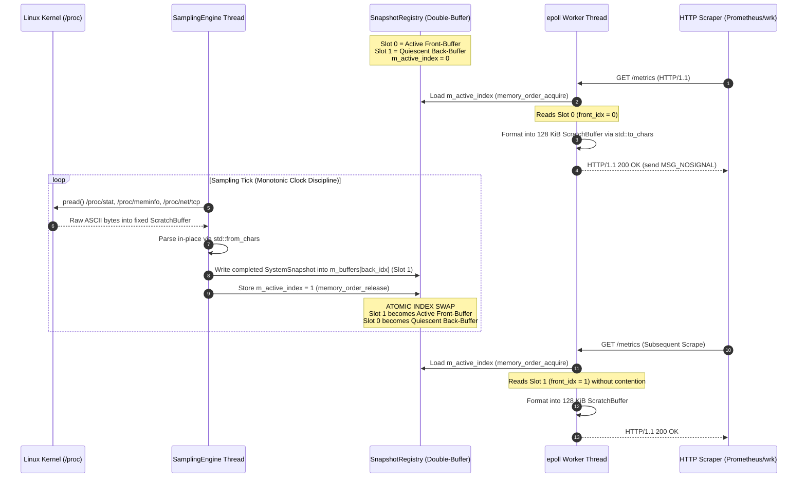

# telemetryd

A **Zero-Allocation Linux Host Telemetry Daemon in Modern C++17**, parsing direct `/proc` kernel metrics and serving them via a high-performance OpenMetrics (Prometheus-compatible) scraper endpoint.

---

## Key Features

- **Strict Zero Heap Allocation**: 0 dynamic allocations (`malloc`, `operator new`) during active sampling, parsing, and scraping, mechanically enforced via `AllocGuard`.
- **Direct `/proc` Parsing**: Zero-copy tokenization with `std::string_view` and `std::from_chars` directly over persistent file descriptors (`O_RDONLY | O_CLOEXEC`), so it doesn't have to repeatedly search for them and open them again.
- **High-Volume TCP Socket Streaming**: Processes unbounded socket tables from `/proc/net/tcp` and `/proc/net/tcp6` in 64 KiB chunks with in-place line boundary splicing (`std::memmove`) to aggregate connection state histograms and kernel queue pressures.
- **Lock-Free Double-Buffered State Machine**: 2-slot snapshot registry (`SnapshotRegistry`) utilizing acquire-release memory barriers for tear-free, wait-free concurrent reads without mutex contention.
- **Drift-Free Sampling Engine**: Monotonic absolute deadline scheduling (`std::chrono::steady_clock`) to eliminate cumulative clock drift.
- **Embedded Dual-Stack HTTP Server**: Handles multiple client connections efficiently using non-blocking dual-stack `epoll` (`IPV6_V6ONLY = 0`) and `accept4` with `TCP_NODELAY`, 500ms Slowloris eviction, and backpressure-aware chunked transmission (`EPOLLOUT`).
- **Prometheus Compliance**: Fully validated with official `promtool check metrics` (correct HELP/TYPE directives, `_total` counter suffixes, fixed 2-decimal precision).
- **Link-Time Optimization (LTO)**: Interprocedural Optimization (IPO) enabled in release builds to allow inlining of frequently used parser functions across files.

> For detailed design specifications, system topology, and memory invariants, see [docs/ARCHITECTURE.md](docs/ARCHITECTURE.md).

---

## Architectural Topologies & Data Flow

### Lock-Free Double-Buffer & Thread Topology
The collector thread (`SamplingEngine`) and asynchronous HTTP worker threads (`epoll`) interact across a two-slot cache-aligned double-buffered state machine without mutex contention:



### Zero-Allocation Data Pipeline
The end-to-end byte flow traces directly from the Linux kernel VFS layer through static stack/scratch buffers to the network wire with strictly zero dynamic heap allocations:

```mermaid
flowchart TD
    subgraph Kernel_Space["Linux Kernel Space"]
        K1["/proc Virtual FS (seq_file)"]
        K2["Socket Tx/Rx Ring Buffers"]
    end

    subgraph Collection_Engine["Sampling & Parsing Engine"]
        F1["Persistent FDs (O_RDONLY | O_CLOEXEC)"]
        S1["Fixed std::array Buffers (ScratchBuffer, alignas 64)"]
        P1["std::string_view / std::from_chars Tokenizers"]
        SNAP["TriviallyCopyable SystemSnapshot (Cache-Aligned 64B)"]
    end

    subgraph Exporter_Engine["HTTP Exporter & Wire Transmission"]
        REG["SnapshotRegistry (Double-Buffered State Machine)"]
        FMT["std::to_chars OpenMetrics Formatter"]
        SCRATCH["128 KiB ScratchBuffer (alignas 64)"]
        WIRE["POSIX send(client_fd, ..., MSG_NOSIGNAL)"]
    end

    K1 -->|"::pread() / ::read() (Zero VFS path walk)"| F1
    F1 -->|Raw bytes| S1
    S1 -->|In-place zero-copy slicing| P1
    P1 -->|Numeric extraction (No sscanf)| SNAP
    SNAP -->|Lock-free publish| REG
    REG -->|Lock-free acquire copy| FMT
    FMT -->|std::to_chars fixed 2-dec precision| SCRATCH
    SCRATCH -->|Zero-copy chunked flush| WIRE
    WIRE -->|Wire frame delivery| K2
```

---

## Benchmark & Verification Summary

Empirical metrics recorded on Linux (`x86_64`) under the optimized Release build (`-O3 -march=native + LTO`):

| Category | Verification Vector | Metric / Target | Measured Result | Status |
| :--- | :--- | :--- | :--- | :--- |
| **Throughput** | `wrk` (4 threads, 100 connections, 30s) | Sustained scrape throughput | **`2,445 – 3,275 req/sec`** | **PASS** |
| **Transfer Rate** | `wrk` payload bandwidth | OpenMetrics wire transfer rate | **`5.03 – 6.73 MB/s`** | **PASS** |
| **Intrinsic Latency** | `wrk` (1 thread, 1 connection) | Isolated median latency ($p_{50}$) | **`160 µs`** (sub-millisecond) | **PASS** |
| **Tail Latency** | `wrk` (4 threads, 100 connections, 30s) | 99th percentile response time ($p_{99}$) | **`179.93 ms`** (0 dropped frames) | **PASS** |
| **Host Overhead** | `bench_parsers` (50,000 passes) | Total collection tick execution cost | **`133.27 µs / tick`** (**`0.013% CPU`** @ 1Hz) | **PASS** |
| **CPU Parser** | `bench_parsers` (`/proc/stat`) | Aggregate + 4 physical cores | **`47.96 µs`** | **PASS** |
| **Memory Parser** | `bench_parsers` (`/proc/meminfo`) | Full memory table decoding | **`50.15 µs`** | **PASS** |
| **TCP Parser** | `bench_parsers` (`/proc/net/tcp`) | State & queue calculation per socket | **`~3.52 µs / socket row`** | **PASS** |
| **Heap Invariant** | `AllocGuard` mechanical interceptor | Steady-state heap allocations (`malloc`/`new`) | **`0 allocations`** | **PASS** |
| **Virtual Memory** | `/proc/<PID>/stat` page-fault delta | New Minor / Major Page Faults during load | **`0 page faults`** (minor=0, major=0) | **PASS** |
| **Memory Leaks** | Valgrind Memcheck (`--leak-check=full`) | Definitely / Indirectly lost heap blocks | **`0 bytes in 0 blocks`** | **PASS** |
| **Descriptor Leaks**| Valgrind (`--track-fds=yes`) & `lsof` | Open file descriptors at clean shutdown | **`0 leaked FDs`** (matches inherited set) | **PASS** |
| **Data Races** | ThreadSanitizer (`-fsanitize=thread`) | 30s stress @ 100 Hz sampling + concurrent HTTP | **`0 data race warnings`** | **PASS** |

---

## Exposed Metric Surface (`GET /metrics`)

| Metric Name | Type | Description |
| :--- | :--- | :--- |
| `host_cpu_utilization_ratio` | `gauge` | Aggregate CPU utilization ratio across user, system, iowait, irq, etc. |
| `host_cpu_core_utilization_ratio` | `gauge` | Per-core CPU utilization ratio labeled with `core="N"`. |
| `host_memory_total_bytes` | `gauge` | Total physical memory in bytes. |
| `host_memory_available_bytes` | `gauge` | Available memory in bytes from `/proc/meminfo`. |
| `host_memory_free_bytes` | `gauge` | Unused physical memory in bytes. |
| `host_memory_buffers_bytes` | `gauge` | Temporary storage for raw disk blocks in bytes. |
| `host_memory_cached_bytes` | `gauge` | In-memory cache for files read from disk in bytes. |
| `host_tcp_sockets_state_total` | `gauge` | Count of TCP sockets labeled by state (`established`, `syn_sent`, `time_wait`, `listen`, etc.). |
| `host_tcp_tx_queue_bytes` | `gauge` | Kernel TCP transmission buffer queue occupancy in bytes. |
| `host_tcp_rx_queue_bytes` | `gauge` | Kernel TCP receive buffer queue occupancy in bytes. |
| `host_scrape_duration_seconds` | `gauge` | Duration of the `/proc` telemetry collection cycle in seconds. |
| `host_scrape_sequence_number_total` | `counter` | Monotonically increasing scrape cycle sequence counter. |

---

## Quickstart & Build Instructions

### Prerequisites
- Linux Kernel 5.x+
- GCC 11+ or Clang 13+ (supporting ISO C++17)
- CMake 3.20+

### Build Presets & Testing

```bash
# Optimized Release Build & Parser Microbenchmarks
cmake --preset release
cmake --build build/release
ctest --test-dir build/release --output-on-failure
./build/release/tests/bench_parsers

# ASan + UBSan Leak and Memory Safety Audit
cmake --preset asan
cmake --build build/asan
ctest --test-dir build/asan --output-on-failure

# ThreadSanitizer (TSan) Concurrency Suite
cmake --preset tsan
cmake --build build/tsan
ctest --test-dir build/tsan --output-on-failure
```
